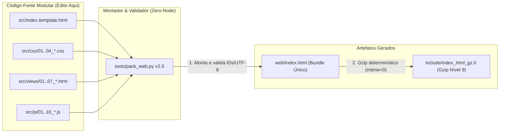

# Arquitetura Web Modular Embarcada — MPS3 Central (`http://mps3.local`)

A aplicação web embarcada do **MPS3** é servida diretamente da Flash SPI do ESP32-S3 através do endpoint `GET /` ([`wifi_transfer.c`](../wifi_transfer.c)) como um único payload compactado em **Gzip nível 9** (`Content-Encoding: gzip`), consumindo **0 bytes de RAM dinâmica** e exigindo apenas **1 socket TCP** no LwIP.

Para garantir escalabilidade, documentação clara e facilidade de manutenção à medida que novos subsistemas (como o **Scraper YouTube/RSS no Navegador**) são adicionados, o código-fonte é organizado de forma **100% modular** em [`src/`](src/).

---

## 1. Fluxo de Build (`src/` $\rightarrow$ `index.html` $\rightarrow$ `index_html_gz.h`)



> [!IMPORTANT]
> **Regra de Ouro**:
> - **SEMPRE edite** os módulos dentro de [`components/wifi_transfer/web/src/`](src/).
> - **NUNCA edite** [`web/index.html`](index.html) ou [`include/index_html_gz.h`](../include/index_html_gz.h) manualmente — ambos são regerados automaticamente por [`tools/pack_web.py`](../../../tools/pack_web.py).

---

## 2. Mapa de Módulos (`components/wifi_transfer/web/src/`)

| Caminho em `src/` | Responsabilidade Técnica | Principais Elementos / Funções |
| :--- | :--- | :--- |
| [`index.template.html`](src/index.template.html) | Esqueleto mestre HTML5 com diretivas `<!-- @include ... -->` | Estrutura `<head>` e `<body>` |
| [`css/01_theme_vars.css`](src/css/01_theme_vars.css) | Variáveis CSS (`:root`, `.dark-theme`), reset global e tipografia | `--bg-page`, `--accent-color`, `body` |
| [`css/02_layout_table.css`](src/css/02_layout_table.css) | Barra de status (Bateria/SD), caixa de upload, tabela e ações em lote | `#header-status`, `#upload-status-box`, `.batch-bar` |
| [`css/03_player_eq_modals.css`](src/css/03_player_eq_modals.css) | Mini Player, Fullscreen Player, modais, faders EQ e responsividade | `#player-bar`, `#fs-player`, `.v-fader`, `.modal-card` |
| [`css/04_wrapped_stats.css`](src/css/04_wrapped_stats.css) | Painel MPS3 Wrapped, gráficos 24h/DNA Hi-Res, estúdio Canvas e ponte QR Mobile | `.wrp-kpi-grid`, `#wrappedCanvas`, `#wrappedMobileLanding` |
| [`views/01_explorer.html`](src/views/01_explorer.html) | Cabeçalho de telemetria, toolbar, busca, breadcrumbs, tabela SD e dropzone | `#batInfo`, `#sdTrafficBox`, `#tbody`, `#dropzone` |
| [`views/02_player_menus.html`](src/views/02_player_menus.html) | Mini Player inferior, Fullscreen Player com `<canvas id="visualizer">` e menu de contexto | `#audioEl`, `#visualizer`, `#ctxMenu` |
| [`views/03_modals_fs.html`](src/views/03_modals_fs.html) | Modais de criação de pasta (`#mkdirModal`) e movimentação/cópia (`#moveModal`) | `#mkdirModal`, `#moveModal` |
| [`views/04_modal_ota.html`](src/views/04_modal_ota.html) | Modal de atualização de firmware OTA com proteção anti-brick | `#otaModal`, `#otaProgressBar` |
| [`views/05_modal_podcasts.html`](src/views/05_modal_podcasts.html) | Modal de Podcasts (Scraper YouTube/RSS no Navegador + Ponte Móvel) | `#podModal`, `#podList`, `#podProgressBox` |
| [`views/06_modals_cfg_eq.html`](src/views/06_modals_cfg_eq.html) | Modal de redes Wi-Fi (`#configModal`) e Equalizador de 10 bandas (`#eqModal`) | `#configModal`, `#eqModal`, `#eqBandsContainer` |
| [`views/07_modal_wrapped.html`](src/views/07_modal_wrapped.html) | Modal de Estatísticas ("MPS3 Wrapped"), Estúdio de Stories HD e Landing Mobile (`?share=wrapped`) | `#wrappedModal`, `#wrappedCanvas`, `#wrpQrBridgeBox`, `#wrappedMobileLanding` |
| [`js/01_theme_head.js`](src/js/01_theme_head.js) | Bootstrap síncrono de tema Claro/Escuro/Auto e Favicon SVG adaptativo | `updateFaviconAndUI()`, `setTheme()`, `toggleTheme()` |
| [`js/02_core_auth_utils.js`](src/js/02_core_auth_utils.js) | Autenticação, dicionário global `el`, estado de navegação e formatadores | `el`, `curPath`, `humanSize()`, `formatTime()` |
| [`js/03_status_explorer.js`](src/js/03_status_explorer.js) | Polling `/api/status`, `/api/list`, renderização da tabela e seleção em lote | `fetchStatus()`, `load()`, `renderTable()`, `updateBatchBar()` |
| [`js/04_web_audio_player.js`](src/js/04_web_audio_player.js) | Web Audio API, EQ local 3 bandas, visualizador FFT e controles de reprodução | `initAudioContext()`, `playFromList()`, `openCtxMenu()` |
| [`js/05_file_ops_modals.js`](src/js/05_file_ops_modals.js) | Operações CRUD no cartão SD (`/api/mkdir`, `/api/move`, `/api/copy`, `/api/delete`) | `openMkdirModal()`, `openMoveModal()`, `deletePathsSequential()` |
| [`js/06_upload_metadata.js`](src/js/06_upload_metadata.js) | Upload recursivo com velocidade/ETA, parser ID3v2/FLAC/M4A e geração de `.cover.jpg` | `pump()`, `extractAndUploadMetadata()`, `resizeAndSendCover()` |
| [`js/07_wifi_and_eq.js`](src/js/07_wifi_and_eq.js) | Gerenciador de redes Wi-Fi (`/api/wifi`) e Equalizador Paramétrico de 10 bandas (`/api/eq`) | `loadWifi()`, `renderEqBands()`, `loadEq()`, `saveEq()` |
| [`js/08_ota_updater.js`](src/js/08_ota_updater.js) | Upload de firmware `.bin` para `/api/ota` com verificação de bateria e reboot | `openOtaModal()`, `closeOtaModal()` |
| [`js/09a_yt_extractor.js`](src/js/09a_yt_extractor.js) | Subsistema Isolado do Extrator YouTube 2026 (`MPS3_YT_EXTRACTOR`, estilo `yt-dlp`) | `CONFIG`, `parseSubscriptionTarget()`, `extractVideosFromBrowseTree()`, `selectBestAudioFormat()` |
| [`js/09_podcast_sync.js`](src/js/09_podcast_sync.js) | Motor Híbrido de Podcasts (Diretório RSS Oficial Apple Podcasts + YouTube `/streams`, retenção Top-3 e sync `/api/sync/*`) | `discoverOfficialRssFeeds()`, `parsePodcastRssXml()`, `BrowserSyncPlanner`, `sha256Bytes()` |
| [`js/10_wrapped_stats.js`](src/js/10_wrapped_stats.js) | Motor Analítico MPS3 Wrapped, Renderizador Social Canvas 1080p, Gerador QR ISO-18004 e Ponte PC $\rightarrow$ Smartphone | `computeWrappedAnalytics()`, `renderWrappedCanvas()`, `sendWrappedToPhoneViaMps3()`, `generateQrSvg()` |

---

## 3. Arquitetura Híbrida de Podcasts: RSS Oficial (Padrão) + Extrator YouTube Isolado (`v2026.10.3`)

1. **Feeds RSS Oficiais (Prioridade Comercial e Legal)**:
   - O botão **`🔎 Buscar RSS Oficial`** (`discoverOfficialRssFeeds()` em `09_podcast_sync.js`) consulta a API pública do Apple Podcasts (`https://itunes.apple.com/search?media=podcast&country=BR`, com `Access-Control-Allow-Origin: *`) diretamente do navegador e preenche o Feed RSS oficial do programa.
   - Os 3 primeiros canais padrão (`NerdCast` via Megaphone, `Vortex` via Anchor/Spotify e `Hora Boa Podcast` via Anchor/CloudFront) utilizam seus Feeds RSS oficiais, tratando automaticamente `<itunes:duration>` quando `<enclosure length="0">` e desembrulhando URLs `/podcast/play/` do Anchor.
2. **Extrator YouTube Isolado (Para Mesacasts Exclusivos em Live, ex: `@DESCEALETRASHOW/streams`)**:
   - O YouTube altera periodicamente versões de cliente (`VISIONOS` / `ANDROID` / `IOS`), protobuf `tabParams` (`/streams`, `/videos`, `/podcasts`) e estruturas JSON (`lockupViewModel`). Por isso, toda a inteligência de extração está isolada em dois arquivos espelhados:
     - **Navegador (JS)**: [`components/wifi_transfer/web/src/js/09a_yt_extractor.js`](src/js/09a_yt_extractor.js) (`MPS3_YT_EXTRACTOR`)
     - **Simulador Local & CLI (Python)**: [`tools/yt_scraper_core.py`](../../../tools/yt_scraper_core.py)

### Como testar ou depurar qualquer canal (ex: `@DESCEALETRASHOW/streams`) em $< 2\text{ s}$ sem o MPS3:

```powershell
# 1. Teste rápido de linha de comando (lista episódios públicos mais recentes, filtra membros e valida stream M4A):
python tools/yt_scraper_core.py "https://www.youtube.com/@DESCEALETRASHOW/streams" --limit 5 --check-audio

# 2. Suíte de testes unitários + integração ao vivo com o YouTube (JS V8 + Python, sem MPS3):
python -m unittest tests/test_yt_extractor.py -v

# 3. Simulador Local Completo da Central Web (Hot-Reload de src/ + Cartão SD Virtual em scratch/virtual_sdcard):
python tools/web_dev_simulator.py --port 8090
```

---

## 4. Comandos de Empacotamento e Suíte Completa de Testes

```powershell
# 1. Montar src/ -> web/index.html -> include/index_html_gz.h e verificar status:
python .agents/skills/web-ui-packager/scripts/web_workflow.py pack

# 2. Executar todas as 4 suítes de testes da Central Web e Scraper (100% sem precisar do ESP32):
python -m unittest tests/test_web_modular_build.py tests/test_web_scraper_engine.py tests/test_browser_podcast_e2e.py tests/test_yt_extractor.py -v
```

